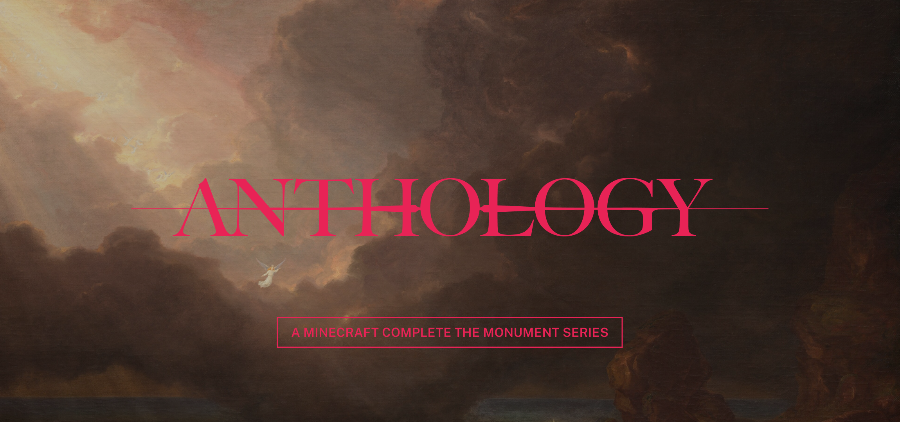

# Anthology CTM

This repository is the archive for *Anthology*, a series of Complete the Monument (CTM) maps for modern Minecraft created by Joey Sweener. 

Evoking that classic feeling of CTM maps from Minecraft's heyday, the series will have players surviving in any way they can as they explore intricately-built dungeons and structures in search of their objectives. Each map makes minimal but tasteful use of data- and resource-packs to enhance the gameplay and aesthetic experience, without straying too far from the core survival Minecraft experience.
